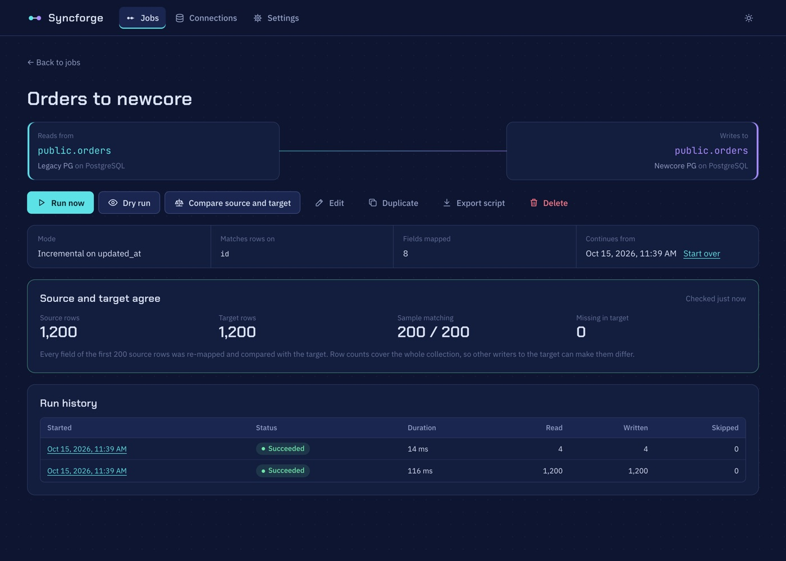

# Syncforge

Build, run and verify data sync jobs between **PostgreSQL**, **MySQL**, **MongoDB** and **Cosmos DB** from a UI, instead of writing another one-off script. Uploaded **CSV files** work as a source too.

Syncforge runs on your machine. You point it at two databases (or a CSV file and a database), pick a table, tick the fields you need, decide how each one lands in the target, and run it. It can then check the result for you: it re-maps a sample of source rows and compares them field by field with what is in the target.

> [!WARNING]
> **Local-only tool, not for production.** Syncforge has no login and trusts everyone who can reach it. It is meant to run on your own machine, bound to `127.0.0.1`, for people who are already trusted with the databases it connects to. Do not expose it to a network, host it as a service, or reuse its code as a pattern for internet-facing applications. See [Security model](#security-model).



## Why

During a platform transition the same task comes up again and again: copy this table from the old database to the new one, rename these fields, convert those values, run it again tomorrow for whatever changed. Each script is small, but there are dozens of them, they are hard to review, and nobody can quickly answer "is the new database actually in sync?".

Syncforge turns those scripts into **job specs**: small JSON files that describe source, target, field mappings and run mode. A job can be previewed before it writes anything, re-run safely at any time, and checked against the target afterwards. Because specs are plain files, the team can review them in pull requests like any other code.

## What it does

- **Browse schemas** of PostgreSQL and MySQL tables and views, and of MongoDB and Cosmos DB collections (fields are inferred by sampling documents, including nested paths like `address.city`).
- **Read CSV files** uploaded in the UI, as a job's source or as a lookup.
- **Join related data**: look up values from other tables or collections, in the same database or a different one (an order's customer email from the CRM), or read a PostgreSQL source through your own SQL query.
- **Map fields** source to target, with transforms: type conversion, trimming, case, fallbacks, fixed values, and JavaScript expressions over the whole row (`row.first_name + ' ' + row.last_name`).
- **Read only some rows** with conditions such as `created_at > 2025-01-31`; the database applies them, so nothing else is read.
- **Preview** before running: the first 10 rows exactly as they would be written, the raw source rows, and the exact query Syncforge will run.
- **Dry run** a saved job: everything a run does except writing, with a report of the rows it would insert, update or leave unchanged.
- **Run** a full copy, or an **incremental** run that only reads rows changed since the last run (by a watermark field such as `updated_at`). Runs stream in batches, show live progress, and can be cancelled.
- **Upsert, never duplicate.** Every write matches on the key fields you choose, so running a job twice is always safe.
- **Compare source and target**: row counts plus a field-by-field check of a sample, listing missing keys and the exact values that differ.

## Quick start

You need Docker.

```bash
mkdir -p workspace          # owned by you, so the container can write to it
docker compose up --build
```

Open <http://localhost:4000>.

The sun/moon button in the top bar switches between the dark and light theme. Until you pick one, the UI follows your system setting.

The **Settings** page holds defaults for this machine: the batch size for new jobs and the CSV upload size limit. They are saved in `workspace/.local/`, not shared through git. If the saved file was edited into an invalid state, the page names the problem and offers *Reset to defaults*.

The app listens on `127.0.0.1` only. To reach a database running on your own machine from inside the container, use the host name `host.docker.internal`.

### Try it with demo data

```bash
docker compose --profile sandbox up --build
```

This also starts a PostgreSQL, a MySQL and a MongoDB with sample data. Add these connections in the UI:

| Name | Type | Settings |
| --- | --- | --- |
| Legacy PG | PostgreSQL | host `sandbox-postgres`, port `5432`, database `legacy`, user `postgres`, password `postgres` |
| New core | PostgreSQL | host `sandbox-postgres`, port `5432`, database `newcore`, user `postgres`, password `postgres` |
| Old CRM | MongoDB | connection string `mongodb://sandbox-mongo:27017`, database `crm` |
| Web shop | MySQL | host `sandbox-mysql`, port `3306`, database `shop`, user `root`, password `mysql` |

Then build a job from **Old CRM / customers** to **New core / public.customers**:

| Source field | Transform | Target field |
| --- | --- | --- |
| `customerRef` | Copy as is | `id` (key) |
| `email` | Expression: `value.trim().toLowerCase()` | `email` |
| (none) | Expression: `row.name.first + ' ' + row.name.last` | `full_name` |
| `address.city` | Copy as is | `city` |
| `active` | To boolean | `is_active` |
| `createdAt` | Copy as is | `signed_up` |

Preview it, save it, run it, then press **Compare source and target**.

A MySQL exercise: **Web shop / products** → **New core / public.products**:

| Source field | Transform | Target field |
| --- | --- | --- |
| `sku` | Copy as is | `sku` (key) |
| `name` | Copy as is | `name` |
| `category` | Expression: `value.trim().toLowerCase()` | `category` |
| `price_cents` | Expression: `value / 100` | `price` |
| `active` | Copy as is | `is_active` |
| `stock` | Copy as is | `stock` |
| `attributes.color` | Copy as is | `color` |
| `updated_at` | Copy as is | `updated_at` |

Run it incrementally on `updated_at`. `shop.order_lines` (2 lines per legacy order, keyed on `order_no` + `line_no`) works well with a lookup to `products` on `sku`, or with a SQL query source that joins them.

`legacy.public.orders` → `newcore.public.orders` is a good second exercise for incremental runs: use `updated_at` as the watermark, run once, change a few rows in `legacy`, and run again. Only the changed rows are read.

## Core ideas

**Connection.** A saved database, or a set of uploaded CSV files. Credentials are encrypted at rest (AES-256-GCM) and never returned by the API. When you edit a connection, leaving the secret blank keeps the saved one.

**Job.** One source collection, one target collection, a list of field mappings, and the key fields used to match rows in the target. *Duplicate* on a job page opens the editor with a copy of that job, named "… (copy)"; nothing is saved until you click *Save*, and the copy starts with no watermark or run history.

**Lookup.** Brings in one matching row from another table or collection, on any connection, for each source row: a many-to-one join such as order → customer. You say which source field matches which lookup field (several pairs for composite keys) and give the lookup a name, say `customer`. Its fields are then mapped like source fields (`customer.email`), and expressions see `row.customer`. A later lookup can match on an earlier one's fields (order → customer → region). Lookups cost one query per batch, not one per row. A row without a match gets empty lookup fields, or, if you mark the lookup required, counts as a row error.

**SQL query source.** For PostgreSQL and MySQL sources you can write a `SELECT` instead of picking a table, which covers joins inside one database, aggregates and filters without creating a view. Give it a name; it shows up in place of a table name. The query runs in a read-only transaction. Syncforge wraps it (`SELECT … FROM (your query) AS q`) to apply field selection and the watermark, so leave out `ORDER BY` and `LIMIT`.

**CSV files.** Create a connection of type *CSV files* (choose the delimiter or leave it on *auto*), then upload files on the Connections page, or with *Upload a file* when picking a source or lookup in the job editor. Each file then shows up like a table.

- Files stay on this machine, in `workspace/.local/uploads/`, readable only by your user. The size limit is set in Settings (default 100 MB, at most 512 MB). A CSV used as a lookup is held in memory during a run, roughly 5× its file size, so the limit also bounds memory.
- The first row must be a header with unique column names. The delimiter is comma, semicolon or tab, or detected from the header (*auto*). Blank lines are skipped.
- Files must be UTF-8; a byte order mark is fine. A file in another encoding is refused at upload rather than read with broken characters: in Excel, save it as *CSV UTF-8*.
- File names can't be names Windows reserves for devices (`con.csv`, `nul.csv`, `com1.csv`, ...).
- Every value is text. An unquoted empty cell is empty (null); a quoted `""` is empty text. PostgreSQL and MySQL convert text to the column's type on write. For MongoDB and Cosmos DB targets, use the *To number*, *To boolean* and *To date* transforms, or every value lands as a string.
- CSV jobs run in *Full copy* mode only; upserts make re-running them safe. A CSV can be a source or a lookup, not a target yet.
- Uploading a file with the same name replaces it, so jobs that use it keep working. Deleting a connection deletes its files.
- An exported script reads the CSV folder from an environment variable named after the connection, such as `PARTNER_FILES_DIRECTORY`. Files there must keep their uploaded names.

**Key fields.** Every write is an upsert on these fields. For PostgreSQL targets they need a primary key or unique constraint. For Cosmos DB the key is always the document `id`.

**Run modes.**

- *Full copy* reads every source row on every run.
- *Only new and changed rows* (incremental) reads rows ordered by a watermark field and remembers the last value it saw. The next run continues from there. It reads `>=` the last value rather than `>`, so rows that share a timestamp are never skipped; re-reading the boundary rows is harmless because writes are upserts. The watermark is saved after every batch, so a failed run resumes where it stopped. **Start over** on the job page resets it.

**Conditions.** *Only rows where* narrows the source with conditions on its own fields (`=`, `≠`, `>`, `≥`, `<`, `≤`). Each value has a type (text, number, date, boolean) so the database compares it correctly; picking a known field picks the type for you. All conditions must match, and they combine with the watermark on incremental runs. They also apply to *Compare source and target*, so counts compare like with like. `≠` also matches rows where the field is empty. Dates without a time zone are read as UTC (`2025-01-31` is midnight UTC). Changing the conditions, query, source or watermark of an incremental job resets its watermark, because rows the old settings left out may lie behind it; the next run reads everything that now matches.

**Dates and times.** Date and time text without an offset (`2025-01-31`, `2025-01-31 08:30`) is read as UTC everywhere: in conditions, the *To date* transform, *Compare source and target*, and PostgreSQL `timestamp` (without time zone) and `date` columns. Results therefore do not depend on the time zone of the machine running Syncforge. Text with an offset (`2025-01-31T08:30+02:00`) keeps it.

**Preview.** *Preview 10 rows* shows three tabs: *Mapped rows* (as they would be written), *Source rows* (as the database returns them, every field, conditions applied, lookups attached) and *Query* (every query a run sends, in order: the source read, each lookup's query with real keys from the preview rows, and the write to the target for the first mapped rows, such as `INSERT … ON CONFLICT … DO UPDATE`). Values are written into the shown queries so you can copy and run them; Syncforge itself always sends values as bound parameters. Lookups are separate queries rather than one SQL join, so they work across databases. For a single SQL join inside one PostgreSQL database, use a SQL query source. *Preview source rows* in the first step works before a target or mappings exist.

**Dry run.** On the job page, *Dry run* reads, looks up, maps and compares every row with the target, but writes nothing and leaves the watermark alone. It reports how many rows would be inserted, updated or stay unchanged, the new keys, and the field values that would change. Like *Compare source and target*, it compares as the target stores values: PostgreSQL and MySQL convert text to the column type, so a different spelling of the same value (`12.5` and `"12.50"`, `true` and `"t"`) is not a change; MongoDB and Cosmos DB keep each value's type, so `"1"` written over `true` is. For Cosmos DB targets it also lists fields a real run would remove, since whole documents are replaced. Rules the target database enforces only on write, such as unique constraints, are not checked; a real run can still refuse rows.

**Run logs.** *Download log* on a run saves a text file with its summary, log, the rows that could not be synced and, for dry runs, the planned changes.

**Row errors.** A row can fail to map (say `"abc"` into *To number*), miss a required lookup, or be refused by the target (say a unique constraint on `email`). Per job you choose what happens:

- *Stop the run* at the first failing row.
- *Skip, retry, and list it.* A failed batch write is repeated row by row, so the other rows of the batch are still written. Rows that failed to write get one more try at the end of the run, which fixes order problems such as a foreign key to a row from a later batch. Whatever still fails is listed with the run: row number, key, step, reason, and the values it tried to write.

**How each target is written.**

| Target | Behaviour |
| --- | --- |
| PostgreSQL | `INSERT … ON CONFLICT (keys) DO UPDATE`, one transaction per batch. Unmapped columns keep their values. Objects and arrays are written as JSON (for `json`/`jsonb` columns). |
| MySQL | In one transaction per batch: look up which keys exist (`SELECT … FOR UPDATE`), `INSERT` the new rows, `UPDATE` the existing ones. Rows are matched on the key fields only: `ON DUPLICATE KEY UPDATE` is not used, because it matches on any unique index and could silently update a different row. A clash on another unique column fails the row, as in PostgreSQL. Unmapped columns keep their values; dates are read and written in UTC, `TINYINT(1)` is read as a boolean, `BIGINT`/`DECIMAL` as exact text. |
| MongoDB | `updateOne` with `$set` and `upsert`. Only mapped fields change; dotted names such as `address.city` update nested fields. BSON types from a MongoDB source are preserved. |
| Cosmos DB | `upsert` of the whole document, keyed by `id` within its partition. Map every field the document needs, including the partition key. |

## Run a job outside the app

*Export script* on a job page downloads `<job>.sync.ts`: the job spec, the settings of every connection it uses, and a call into the engine's standalone runner. It runs the job with the engine's own code (connectors, lookups, transforms, upserts, error policy), so the result is the same as a run in the app.

Secrets are never in the file. Each one is read from an environment variable named in the file's header, such as `LEGACY_PG_PASSWORD` or `OLD_CRM_URI`. A CSV connection's folder comes from one too (`<CONNECTION>_DIRECTORY`), since it differs per machine.

```bash
npm run build --prefix engine            # once, and after updating Syncforge
cd engine
LEGACY_PG_PASSWORD=… OLD_CRM_URI=… npx tsx path/to/orders.sync.ts --dry-run
LEGACY_PG_PASSWORD=… OLD_CRM_URI=… npx tsx path/to/orders.sync.ts
```

Outside the repository, install the engine into your project first (`npm install <syncforge>/engine`). The script prints its log, lists rows that could not be synced, and exits with `0` (all synced), `2` (some rows not synced) or `1` (run failed), so it fits cron or CI. Incremental jobs keep their watermark in `<job>.state.json` in the working directory, separate from the app's. Host names saved for the Docker app (`host.docker.internal`) may need to be `localhost` when the script runs on your machine.

## Sharing jobs with the team

Everything Syncforge stores lives in `workspace/`:

```
workspace/
  jobs/        job specs, one JSON file each. Commit these.
  .local/      secrets, connections, uploaded CSV files, run history, watermarks, latest reconcile counts, app settings. Never commit (git-ignored automatically).
```

Job specs refer to connections by id. To use a colleague's job, create connections with the same ids on your machine, or open the job and pick your own connections.

## Run without Docker

Requires Node.js 20 or later.

```bash
npm run setup          # installs engine and ui dependencies
npm run dev:engine     # API on http://127.0.0.1:4000, restarts on change
npm run dev:ui         # UI on http://localhost:5173, proxies /api to the engine
```

To run a production build: `npm run build`, then from `engine/`: `UI_DIR=../ui/dist npm start`.

## Configuration

| Variable | Default | Purpose |
| --- | --- | --- |
| `PORT` | `4000` | HTTP port. |
| `HOST` | `127.0.0.1` | Interface to listen on. The Docker image sets `0.0.0.0` and compose publishes it on loopback only. |
| `WORKSPACE_DIR` | `./workspace` | Where specs, connections and history are stored. |
| `SYNCFORGE_SECRET_KEY` | generated | Base64 32-byte key for credential encryption. If unset, one is generated at `workspace/.local/secret.key`. Back it up: without it, saved connections cannot be decrypted. |
| `UI_DIR` | unset | Folder with the built UI to serve next to the API. |
| `CORS_ORIGIN` | `http://localhost:5173` | Allowed origin for the UI dev server. |

## Tests

```bash
npm test                   # unit tests, no database needed
npm run test:integration   # connectors against real databases, needs Docker
```

Both run in the `Europe/Athens` time zone, so date handling that depends on the machine's zone fails everywhere, not only abroad.

Unit tests cover value normalization, CSV parsing, path handling, every transform (including expression timeouts), SQL generation, schema inference, and the run loop (batching, de-duplication, skip policy, watermark checkpoints, cancellation).

Integration tests start PostgreSQL 16, MySQL 8.4, MongoDB 7 and the Cosmos DB emulator in throwaway containers (Testcontainers) and run every connector through the same contract, plus whole jobs on the sandbox data. The first run pulls the images, which takes a few minutes; later runs take seconds. The Linux "vnext" Cosmos DB emulator is used because it runs on both Apple Silicon and x64.

## Upgrading

Since PostgreSQL `timestamp` (without time zone) and `date` values are read as UTC, watermarks saved by an earlier version may be off by the machine's offset from UTC. Each incremental job (in the app and in exported scripts) therefore resumes up to 14 hours earlier once, re-reading a few rows rather than skipping any; writes are upserts, so that is harmless. `timestamp` values that an earlier version wrote into PostgreSQL on a machine outside UTC were stored in local time and shift to the UTC wall time on the next full run.

## Security model

Syncforge is a **local developer tool**. Its safety comes from where it runs, not from access control, so the points below hold only while it stays on your own machine.

**What it assumes**

- **Everyone who can reach the API is trusted.** There is no login, no user accounts and no permissions. The engine listens on `127.0.0.1` by default, and the Docker setup publishes it on loopback only.
- **Job authors are trusted.** Expressions are JavaScript that runs in the engine's process (`node:vm` with a 50 ms limit per row); this stops mistakes, not attacks. SQL query sources are your own SQL, run inside a READ ONLY transaction.
- **The people using it may already read and write the connected databases.** Syncforge acts with the credentials you give it.

**What it protects**

- Saved credentials are encrypted at rest (AES-256-GCM) and never returned by the API.
- Identifiers and values are quoted or bound as parameters; uploaded CSV file names are checked, sizes are capped, and error messages never include cell values.
- Workspace secrets, run history and uploaded files live under `workspace/.local/`, which is kept out of git and out of the Docker image, and a secret scan runs on every commit and push.

**What it does not do**

- No authentication, authorization, rate limiting or audit log.
- No protection when it is reachable from other machines: anyone who can open the UI can read every connected database, write to targets and run code on the host.

**So, please don't**

- Change `HOST` or the published port to expose it beyond your machine, or put it behind a public reverse proxy.
- Run it as a shared server or a hosted service.
- Copy its endpoints, upload handling or expression runner into a production application as they are. They are written for the trusted, local setting above.

Found a security problem? See [SECURITY.md](SECURITY.md).

## Know before you use it

- **Deletes are not synced.** A row deleted in the source stays in the target. *Compare source and target* shows the count difference.
- **Lookups are many-to-one.** Each source row picks up at most one related row (the first match). Collecting many related rows into an array (customer → orders[]) is not supported yet.
- **Incremental runs follow the source only.** A change in a looked-up row does not make its source rows count as changed. Reset the watermark (*Start over*) to refresh them.
- **Conditions compare types strictly in MongoDB and Cosmos DB.** Pick the value type that matches how the field is stored (a number stored as text needs a *text* condition). Conditions on MongoDB `_id` are not supported.
- **Lookup keys are matched by the lookup database.** PostgreSQL and MySQL convert types (`'42'` finds `42`); MongoDB and Cosmos DB compare types strictly, so a text key will not find a numeric one. If the types differ, cast the key in a SQL query source (`SELECT order_no::text AS order_ref, …`).
- **Expressions are trusted code.** They run in a separate context with a 50 ms limit per row, which stops mistakes like infinite loops but is not a security sandbox. Anyone who can edit a job can run code on the machine running Syncforge, which is why it is a local, loopback-only tool.
- **CSV files are a source only, in full mode.** They cannot be a target yet, and incremental runs are not available for them.
- **Target tables are not created for you** in PostgreSQL, MySQL or Cosmos DB. MongoDB creates collections on first write.

## Keeping credentials out of git

`npm run setup` turns on a pre-commit hook (`.githooks/pre-commit`) that scans staged changes and stops a commit containing something that looks like a credential: `.env` files, workspace secrets, private keys, cloud and GitHub tokens, connection strings with a password, or passwords written in code. The same check runs on every push and pull request in GitHub Actions (`.github/workflows/secret-scan.yml`), so a commit made with `--no-verify` is still caught. Run it by hand with `npm run check:secrets`.

Known harmless values (documentation placeholders, the public Cosmos DB emulator key, the throwaway demo and test database passwords) are allowed in `scripts/check-secrets.mjs`. Mark any other harmless example line with a `secret-scan: allow` comment.

## Documentation

- [docs/ARCHITECTURE.md](docs/ARCHITECTURE.md): how the engine is built, the guarantees it gives, and how to add a database or a transform.

## License

[MIT](LICENSE) © 2026 Mohamed Raslan
