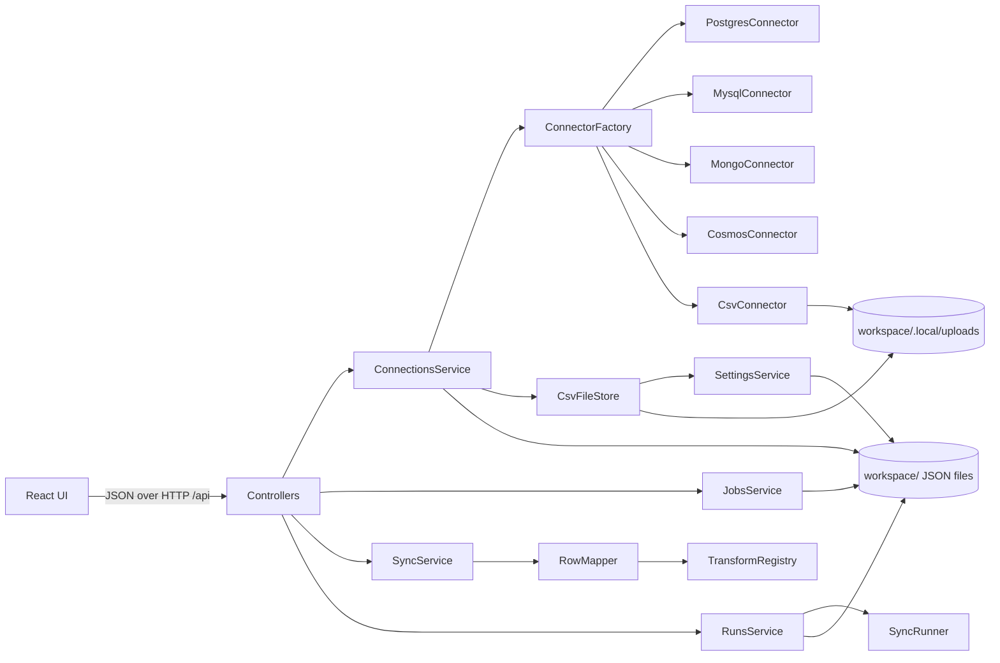

# Architecture

Syncforge is two TypeScript applications in one repository:

- **engine/**: a NestJS service that holds connections and jobs, talks to the databases, and executes runs.
- **ui/**: a React single-page app (Vite) that only talks to the engine's HTTP API.

In production one Docker image runs the engine, which also serves the built UI, so the whole tool is one process on one port.

## Engine modules

| Module | Responsibility |
| --- | --- |
| `core.module.ts` | Process-wide singletons: configuration, workspace, encryption, transform registry, connector factory. |
| `connections/` | CRUD for saved connections, encryption of their settings, connection tests, schema browsing. `CsvFileStore` keeps the uploaded files of CSV connections in `workspace/.local/uploads/<connectionId>/`; `ConnectionsService` adds that folder to a CSV connection's config when it opens a connector. |
| `connectors/` | One class per database engine, plus `CsvConnector` for uploaded files, behind a common `Connector` interface. `ConnectorFactory.create` takes a `ConnectorConfig`: the stored settings plus any runtime context a connector needs (a CSV connection's folder). Pure SQL builders live next to the Postgres connector; pure CSV helpers (delimiter detection, file name rule, cell and header rules, in-memory filters, explain text, error messages) in `csv/csv-format.ts`. |
| `transforms/` | The registry of field transforms. |
| `jobs/` | Job specs (validation, CRUD), incremental state (watermarks), and `RunLocks`. |
| `sync/` | Everything about executing a job: `RowMapper`, `SyncRunner`, `SyncService` (preview, reconciliation), `ReconcilesService` (keeps the latest reconcile's counts), `RunsService` (background runs and history). |
| `settings/` | App-wide, machine-local settings (`SettingsService`, global so any module can read them): default batch size for new jobs, CSV upload limit. Stored in `workspace/.local/settings/app.json`; every field has a default, so missing or older files still load. A file that no longer parses is a `ConflictError` (409) naming the file and field; `PUT /settings` never reads the old file, so saving repairs it. |
| `storage/` | `JsonDirectoryStore` (one entity per JSON file, atomic writes), `SecretBox` (AES-256-GCM), `Workspace` (folder layout). |
| `common/` | Errors and their HTTP mapping, zod validation pipe, value normalization and comparison, path helpers. |

Dependencies point one way: `sync` → `jobs` → `connections` → `connectors`. `RunLocks` lives in `jobs` so that deleting a running job can be refused without `jobs` knowing about the runner.

## Life of a run

1. `POST /api/jobs/:id/runs` reaches `RunsService.start`. It takes the job's lock (a second start gets `409`), reads the stored watermark for incremental jobs, saves a run record and returns `202` immediately.
2. In the background, `SyncService.withPipeline` compiles the mappings into a `RowMapper` first, so a broken expression fails before any database is opened. It then opens the source, target and lookup connectors and checks rules that depend on which databases are involved (for example, Cosmos DB targets must be keyed on `id`).
3. `SyncRunner.run` loops:
   1. Read a batch from the source. Postgres uses a server-side cursor, MongoDB a cursor, Cosmos DB continuation pages, so memory use is bounded by the batch size. The job's conditions (`source.filters`) are part of the database query, combined with the watermark, so rows outside them are never read. Each connector builds that query in one function used by both `readBatches` and `explainRead`, so the previewed statement is the executed one. A CSV source streams its file through `csv-parse` and applies the conditions in memory, reading each cell as the condition's type.
   2. Apply the job's lookups (`LookupEnricher`): for each lookup, collect the batch's distinct match keys, fetch the matching rows with one `findByKeys` call (chunked for large batches; a CSV lookup indexes its file once per run and answers from memory), and attach each match to its row under the lookup name.
   3. Map each row and check that key fields are not empty. Depending on the job's error policy, a failing row stops the run or is skipped and reported (`RunHooks.onRowFailed`).
   4. De-duplicate the batch by key (last row wins).
   5. Upsert the batch into the target. With the skip policy, a failed batch is written again one row at a time, so only the refused rows are set aside; this is safe because upserts are idempotent. Set-aside rows get one more try after the last batch, and those that still fail are reported with their values and the database's reason. The run record keeps the first 500. Every failure carries the row's `sourceKey` when the job has one (see *Re-running failed rows*).
   6. Report progress and the new checkpoint. `RunsService` persists the watermark immediately and flushes the run record to disk at most once a second.
4. A retry (`{ "retryOf": runId }`) is the same loop with a different row source. `RunsService` checks the earlier run (same job, finished, not a dry run, failures with a usable `sourceKey`) and collects its distinct source keys; `KeyedRowsReader` implements the runner's `RowSource` by fetching those rows with the source connector's `findByKeys`, `KEYS_PER_QUERY` keys at a time, and handing them out in `batchSize` batches. Keys it no longer finds become `read` failures. The runner gets the job as a full run, so no watermark is read or checkpointed, and the hooks never save one for a retry.
5. Cancelling aborts an `AbortSignal` that both the runner and the connectors check between batches. Rows already written stay written.
6. The run ends as `succeeded`, `failed` or `cancelled`, the lock is released, and history is pruned to the newest 30 runs per job. Runs still marked `running` when the engine starts (after a crash) are marked `failed`.

## Guarantees and their reasons

**Idempotent writes.** Every connector's `upsert` matches on the job's key fields. Running a job twice leaves the target unchanged, which is what makes retries, resumed runs and `>=` watermarks safe.

**No lost rows on incremental runs.** Rows are read in watermark order, and the checkpoint is the watermark of the last row read, taken from the database's own ordering rather than recomputed in JavaScript, so collation differences cannot skip text watermarks. The next run starts at `>=` that value, so rows sharing the boundary value are re-read rather than missed. Date watermarks are saved with `utc: true` (`StoredWatermark`); one without it was saved before naive Postgres timestamps were read as UTC and may carry the old machine's offset, so `upgradedWatermark` moves it 14 hours earlier (the largest UTC offset) and marks it. `SyncRunner` starts from that value, logs that it did, and checkpoints it even when the run reads no rows, so it moves only once; the hooks still never save a dry run's watermark. `fromStoredWatermark` applies the same upgrade, so every connector and the standalone script's state file agree.

**CSV connections are read-only and run in full mode.** `assertCompatible` refuses a CSV target and an incremental job with a CSV source, and `CsvConnector.upsert` refuses to write. A file has no reliable change marker (each upload replaces it), so every run reads it whole; upserts make that safe. Replacing a file keeps its name, so jobs that refer to it keep working.

**Atomic batches in PostgreSQL.** Each batch is written in one transaction. Large batches are split into several statements to stay below the 65,535 bind parameter limit.

**Values survive the trip.** Drivers return their own types (BSON `ObjectId`, `Decimal128`, `bigint` as strings, `Buffer`). `normalizeValue` converts them to portable values before they cross into a different database or into JSON. MongoDB-to-MongoDB jobs keep BSON types because the Mongo connector writes values as they come.

**Verification compares as the target stores values.** Reconciliation and dry runs pick the comparison with `comparisonFor(targetKind)` (`sync/row-diff.ts`). SQL targets (PostgreSQL, MySQL) convert bound text to the column type, so they use the representation-tolerant `valuesEqual`, which treats as equal: `12.5` and `"12.50"`; two plain decimal texts of the same value (`"12.5"` = `"12.50"`, `"-3"` = `"-3.0"`, but `"00123"` ≠ `"123"`, and `"1e3"` or `" 12"` are plain text); a boolean and `"t"`/`"true"`/`"1"` or `"f"`/`"false"`/`"0"` in any case (text against text is never read as boolean); a `Date` and date text or epoch milliseconds; a JSON string and the parsed object. The price of the decimal rule: version-like texts in a text column compare as numbers (`"1.10"` = `"1.1"`), so rewriting one as the other is reported as unchanged. MongoDB and Cosmos DB store each value with its type and match types strictly, so they use `documentValuesEqual`: a change of type between text, number and boolean is a difference (`"1"` written over `true`, `"1"` over `1`), texts compare exactly, and JSON text is not an object; only null vs missing, driver types after `normalizeValue`, and a `Date` read back as its ISO text (Cosmos DB) are tolerated. Date text without an offset means UTC (`parseDateText`), as do the `date` transform and date conditions, so results do not depend on the machine's time zone. The drivers follow the same rule: Postgres `timestamp` (without time zone) and `date` columns are read as UTC (a per-pool type parser) and Dates are bound as UTC ISO text, MySQL uses `timezone: 'Z'` for DATETIME/DATE in both directions; unit and integration tests run with `TZ=Europe/Athens` to prove it. Row identity uses `keyString`, which matches `1` and `"1"`, an `ObjectId` and its hex, but keeps `"12.5"` and `"12.50"` (or `true` and `"t"`) apart: a text key column holds them as different rows. This is a deliberate asymmetry with `valuesEqual`: two keys it calls equal values can still be different rows.

**Re-running failed rows reads only those rows.** `sourceKeyFields(job)` (`sync/source-key.ts`) is, per target key field, the source field its mapping copies. Any transform that reads only that field is fine, because the retry fetches by the raw source value, not the transformed one; an expression (may read any field), a constant (reads none) or a default (turns an empty value, which no key lookup finds, into a key) is not, nor is a key from a lookup or a SQL query source (no key to fetch a row of a query by). A key value is kept only when it is text or a number (`sourceKeyOf`): a date or an `ObjectId` would come back from the run record's JSON as text, which MongoDB and Cosmos DB never match. The job's conditions are not re-applied, since the rows are asked for by key. `latestByJob` skips finished retries as it skips dry runs: a retry covers only some rows, so the retried run still describes the job.

**Latest reconcile kept as counts only.** After a successful reconcile, `ReconcilesService` saves a `ReconcileSummary` (counts and `checkedAt`) to `workspace/.local/reconciles/<jobId>.json`, replacing the previous one; a failed reconcile saves nothing. Missing keys and mismatched values are never stored, because they are customer data. Like run history, a summary is kept when its job is deleted.

## Security model

- The engine binds to `127.0.0.1` by default. The Docker image binds to `0.0.0.0` inside the container, and compose publishes the port on loopback only.
- Connection settings are encrypted with AES-256-GCM. Only a connection's name and type are stored in clear text. The API never returns the secret field (`password`, `uri` or `key`).
- SQL identifiers are always quoted and values always bound as parameters. Field paths are validated so they cannot contain `$` (MongoDB operators) or `__proto__`-style segments.
- SQL query sources run in a read-only transaction, so a query (or a function it calls) cannot modify the source database. Like expressions, they run with the connection's privileges, which is why the connection's user should only be able to read what the job needs.
- CSV uploads are written to `workspace/.local/uploads/<connectionId>/`. The folder is created owner-only (`0700`) and files are written `0600`, like the rest of the local state. File names must match `CSV_FILE_NAME` (no folders, no leading dot, ending in `.csv`, not a Windows device name such as `con.csv`), so a name cannot leave that folder. The size limit (`csvMaxUploadMb`, default 100 MB, at most 512 MB; a CSV lookup is held in memory as parsed rows, roughly 5× the file size, so it also bounds memory) comes from Settings at each upload: a declared `Content-Length` over it is refused before reading, and the bytes are counted as they stream, for chunked uploads. The bytes are also decoded as they stream with a fatal UTF-8 `TextDecoder`, so a file in another encoding (Excel's plain "CSV" is Windows-1252) is refused instead of read with U+FFFD in place of its characters. A refused stream (too large, not UTF-8) stops writing but reads the rest of the request, so the client gets the 400 instead of a reset connection. A file is written to a temporary `.<name>.<random>.part` file, its header row is checked, then it is renamed into place, so a refused or broken upload leaves the previous file untouched and no temporary file behind. Blank lines are skipped, at upload and when reading. Error messages name the file, line numbers and columns, never cell values: `csv-parse` messages can contain them, so `csvErrorMessage` builds its own text from the error code and line numbers. Uploads are customer data: they are deleted with their connection, whatever its kind is by then.
- Expression transforms run in a `node:vm` context with a per-row timeout. That isolates globals and stops runaway loops, but it is **not** a security boundary. Whoever can edit a job can run code on the host. This is acceptable for a local tool used by the engineers who own the databases, and is one more reason the tool is not meant to be exposed on a network.

## Design choices

**Strategy and Factory for databases.** `Connector` is the strategy interface, composed of smaller interfaces (`SchemaReader`, `DataReader`, `KeyReader`, `DataWriter`) so consumers depend only on what they use: the runner needs a reader and a writer, lookups only a `KeyReader`.

**Dry run as a writer.** A dry run is the normal run loop with the target writer replaced by `DryRunWriter`, which implements `DataWriter` by looking rows up (`findByKeys`) and recording inserts, updates and field changes instead of writing. Batching, lookups, mapping, the error policy and cancellation therefore behave exactly as in a real run. `RunsService` keeps the report on the run record and never saves the watermark of a dry run.

**Standalone scripts reuse the pipeline.** `src/standalone.ts` (exported as `sync-forge-engine/standalone`) composes the same `SyncService`, `SyncRunner`, lookups, transforms and `DryRunWriter` without NestJS. `SyncService` depends only on `ConnectionOpener` (`open(id)`), so the app passes `ConnectionsService` and a script passes its own settings, with secrets from environment variables. `jobs/job-script.ts` generates the script; its watermark lives in a local state file instead of the workspace.

**Lookups instead of a join engine.** A lookup reuses `findByKeys`, which every connector already has for reconciliation, so joining across PostgreSQL, MySQL, MongoDB and Cosmos DB needed no new connector code and no staging database. The cost is that lookups are many-to-one and keyed: arbitrary joins inside one PostgreSQL or MySQL database go through a SQL query source instead, where the database does the work. Query sources are wrapped as subqueries rather than edited, so watermarks and projections apply without parsing SQL, and they run in a read-only transaction. `ConnectorFactory` is the single place that maps a connection type to a class.

**Strategy registry for transforms.** Each transform is a definition with a `compile(argument)` method that returns a per-row function. Arguments are validated and expressions compiled once per job, not once per row.

**Repository over plain JSON files.** `JsonDirectoryStore` writes one file per entity with an atomic rename. It avoids a database dependency in a tool whose job is talking to databases, keeps job specs diff-friendly for review in git, and keeps machine-local state (secrets, history, watermarks) in a separate git-ignored folder.

**Validation at the edge.** zod schemas define the API contract. Cross-field rules (incremental needs a watermark, key fields must be mapped, no duplicate targets) live in the schema. Rules that need to know the database types run when a job is opened (`assertCompatible`).

**Things deliberately left out.** No queue, no scheduler, no ORM, no shared types package between engine and UI. Each would add moving parts that a local tool for a handful of engineers does not need yet. UI types in `ui/src/api/types.ts` mirror the engine's and are kept in sync by hand.

## Extending

### Adding a database

1. Add a config schema to `connections/connection.model.ts`, include it in `connectionConfigSchema` and `connectorConfigSchema`, and add its secret field to `SECRET_FIELD` and `SECRET_REQUIRED` (`null` and `false` if it has none). If the connector needs context that is not a stored setting (as CSV needs its folder), extend its schema in `connectorConfigSchema` only and add it in `ConnectionsService.connectorConfigFor`; `standalone.ts` and `job-script.ts` (`scriptEnvField`) then need to supply it from the environment.
2. Implement `Connector` in `connectors/<name>/<name>.connector.ts`. Reuse `inferSchema` if the store is schemaless, and `normalizeValue` for values written to it.
3. Add a case to `ConnectorFactory.create`. TypeScript's exhaustiveness check points at anything you missed.
4. Add the form fields in `ui/src/pages/ConnectionForm.tsx` and a label in `KIND_LABEL`.

### Adding a transform

Add a name to `TRANSFORM_NAMES` and a definition to `DEFINITIONS` in `transforms/transform.registry.ts`, with a test in `test/transforms.spec.ts`. The UI picks it up from `GET /api/transforms`.

## HTTP API

All routes are under `/api`. Errors are JSON with a `message` and, for validation errors, `issues: [{ path, message }]`.

| Method and path | Purpose |
| --- | --- |
| `GET /connections` · `POST /connections` | List and create connections. |
| `GET/PUT/DELETE /connections/:id` | Read, update (blank secret keeps the saved one), delete. |
| `POST /connections/test` | Test settings before saving. Pass `connectionId` to fall back to a saved secret. |
| `GET /connections/:id/collections` | Tables, views, collections or containers. |
| `GET /connections/:id/fields?collection=` | Field list (inferred for document stores). |
| `POST /connections/:id/query-fields` | Columns a SQL query returns (PostgreSQL and MySQL), without reading rows. |
| `GET /connections/:id/files` | CSV connections only: `{ maxBytes, files: [{ name, size, modifiedAt }] }`, with the upload limit in bytes. |
| `PUT /connections/:id/files/:name` | CSV connections only: upload one file as the raw body (`content-type: text/csv`), replacing a file of that name. Returns its `{ name, size, modifiedAt }`. |
| `DELETE /connections/:id/files/:name` | CSV connections only: delete one uploaded file (`204`). Deleting the connection deletes all its files. |
| `GET /transforms` | Available transforms. |
| `GET /jobs` · `POST /jobs` | List and create jobs. |
| `GET/PUT/DELETE /jobs/:id` | Read, update, delete (refused while running). |
| `GET /jobs/:id/export` | `{ fileName, content }` of a runnable `<job>.sync.ts` (connection settings without secrets). |
| `POST /jobs/preview` | Map the first 10 rows of an unsaved job without writing; includes the write statement for the first mapped rows. |
| `POST /jobs/source-preview` | First source rows (conditions applied, lookups attached), the read statement and each lookup's query; needs no target or mappings. |
| `POST /jobs/:id/runs` · `GET /jobs/:id/runs` | Start a run (`202`; body `{ "dryRun": true }` for a dry run, `{ "retryOf": runId }` to re-run that run's failed rows; not both), list history. |
| `POST /jobs/:id/reconcile` | Compare counts and a 200-row sample between source and target. Stores the counts as the job's latest reconcile. |
| `GET/DELETE /jobs/:id/watermark` | Read or reset the incremental watermark. |
| `GET /reconciles/latest` | Counts of the latest reconcile per job id (`ReconcileSummary`; no keys or values). |
| `GET /runs/latest` · `GET /runs/:id` · `POST /runs/:id/cancel` | Latest run per job (finished dry runs and retries do not count), run detail with log, cancel. |
| `GET /settings` · `PUT /settings` | `{ settings, defaults }` with `defaultBatchSize` and `csvMaxUploadMb`. `PUT` takes the whole settings object; omitted fields take their defaults, so `PUT {}` resets them. `GET` answers `409` when the saved file is invalid; `PUT` still works. |
| `GET /health` | Liveness. |

## Testing

`engine/test/` holds unit tests for the pure parts (values, paths, transforms, SQL builders, schema inference, job validation) and for `SyncRunner` and `LookupEnricher` with in-memory readers and writers. They contain the tricky logic (batching, de-duplication, error policy, checkpoints, cancellation, lookup matching) and do not need a database to test. `vitest.config.ts` and `vitest.integration.config.ts` both set `TZ=Europe/Athens`, a zone that is never UTC: date code that reads offset-less text as local time, or a driver that reads naive columns as local time, fails on every machine, CI included, instead of only on machines outside UTC.

`engine/test/integration/` runs the connectors against real databases in containers (`npm run test:integration`, needs Docker). It is kept out of `npm test` so unit tests stay fast and need nothing installed.

| File | What it covers |
| --- | --- |
| `containers.ts` | Starts PostgreSQL 16, MySQL 8.4, MongoDB 7 (optionally seeded from `sandbox/`) and the Linux "vnext" Cosmos DB emulator with Testcontainers. |
| `connector-contract.ts` | Behaviour every connector must have: ping, listing, describing, counting, batched and limited reads, inclusive watermark reads in order, cancellation, idempotent upserts, key lookups. Each connector's spec runs it. |
| `mysql.spec.ts` | Matching on key fields only (a clash on another unique column fails instead of updating another row), all-or-nothing batches, composite keys, booleans/JSON/big integers/UTC dates, read-only query sources, a `?` inside a user query left alone, MySQL-to-MySQL incremental job with reconcile. |
| `postgres.spec.ts` | All-or-nothing batches, splitting above the bind parameter limit, jsonb writes, nested paths read through their column, SQL query sources (reading, counting, watermarks, column types, the read-only guard), naive `timestamp`/`date` columns as UTC, including a watermark saved by an older engine west of UTC. |
| `mongo.spec.ts` | `$set` keeps unmanaged fields, dotted names update nested fields, composite keys, BSON types survive a MongoDB-to-MongoDB copy, ObjectId watermarks. |
| `cosmos.spec.ts` | Numeric ids, nested partition keys, partition key and id checks, whole-document replacement, system fields stripped. |
| `csv.spec.ts` | CSV sources end to end: text cells into typed PostgreSQL and MySQL columns (null kept apart from empty text, semicolon delimiter), offset-less date-times into naive date columns, MongoDB targets with transforms, a CSV lookup matching integer keys, a numeric condition, reconcile and idempotence, re-running a failed row fetched from the file by key. |
| `job-script.spec.ts` | Exported `.sync.ts` scripts: missing secrets or CSV folder named, dry run, incremental state file (and an older unmarked watermark resuming 14 hours earlier), a CSV source read from the folder in the environment. |
| `sync.spec.ts` | Whole jobs on the sandbox data through `SyncService` and `SyncRunner`: the README's MongoDB-to-PostgreSQL job with reconciliation catching a tampered value and a deleted row; an incremental PostgreSQL-to-MongoDB job whose second run reads only the changed rows; PostgreSQL orders enriched from MongoDB customers by a lookup, including a missing required match; an aggregate SQL query source run incrementally; re-running the failed rows of an incremental PostgreSQL-to-PostgreSQL run after fixing the job (only those rows read, the watermark untouched, a row deleted at the source listed). |

The HTTP flow, run locking and a 400,000-row backfill were verified by hand against PostgreSQL 16 during development and are not automated.

## Known limitations

- Deletes are not propagated; lookups are many-to-one; incremental runs only notice source changes, not lookup changes.
- Target PostgreSQL and MySQL tables and Cosmos DB containers must already exist.
- CSV files are a source or lookup only, in full mode. A CSV target is phase 2: `CsvConnector` already sits behind the full `Connector` interface, so it needs `upsert` and the `assertCompatible` rule lifted.
- MySQL `TIMESTAMP` columns follow the server's session time zone; the connection is not yet forced to UTC (`DATETIME` and `DATE` are, through `timezone: 'Z'`).

## Roadmap

1. One-to-many lookups: collect related rows into an array (customer → orders[]) for document targets.
2. Delete propagation: soft-delete flags, or a key diff against the source.
3. Change data capture: Postgres logical replication, MongoDB change streams, the Cosmos DB change feed.
4. Scheduling: run jobs on an interval while the engine is up.
